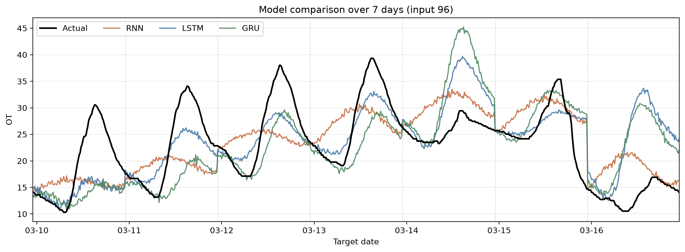
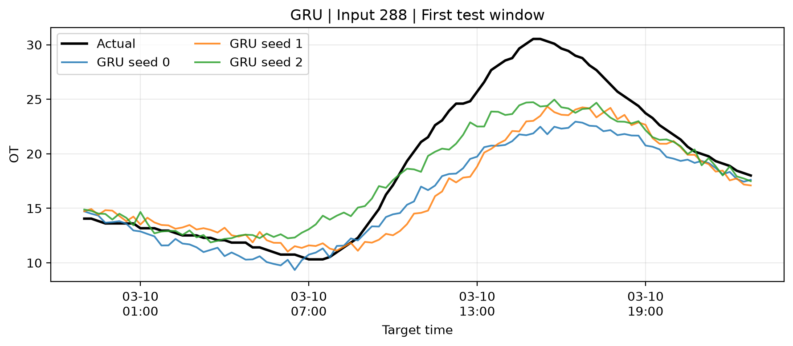

# ETTm2 Oil Temperature Forecasting

This repository contains a multistep time-series forecasting project completed during the **Apprentice Project** course.

The project compares RNN, LSTM, and GRU models for predicting the next 24 hours of transformer oil temperature using the ETTm2 dataset. An additional experiment investigates how the length of historical input affects GRU forecasting performance.

## Project Overview

- Compare RNN, LSTM, and GRU under the same input and training settings.
- Predict 96 future time steps (24 hours) from multivariate time-series inputs.
- Select the model and input length based on mean validation MSE across three random seeds.
- Compare GRU input lengths of 96, 192, and 288 time steps.
- Evaluate all experimental conditions on the held-out test set.

## Dataset

- **Dataset:** ETTm2 (Electricity Transformer Temperature)
- **Source:** [ETDataset](https://github.com/zhouhaoyi/ETDataset)
- **Records:** 69,680 (15-minute intervals)
- **Input features:** `HUFL`, `HULL`, `MUFL`, `MULL`, `LUFL`, `LULL`, `OT`
- **Prediction target:** `OT` (oil temperature)
- **Data split:** Train 70% / Validation 15% / Test 15% (chronological)

## Project Structure

```text
ettm2-oil-temperature-forecasting
├── README.md
├── notebooks
│   └── 01_ettm2_oil_temperature_forecasting.ipynb
├── data
│   └── ETTm2.csv
├── results
│   ├── base_validation_runs.csv
│   ├── base_validation_summary.csv
│   ├── base_test_summary.csv
│   ├── GRU_ablation_validation_runs.csv
│   ├── GRU_ablation_validation_summary.csv
│   ├── GRU_ablation_test_summary.csv
│   ├── test_runs.csv
│   ├── selection_before_test.json
│   └── figures
│       ├── base_models_input96_7days.png
│       ├── base_models_input96_7days.csv
│       ├── base_models_input96_prediction_example.png
│       ├── base_models_input96_prediction_example.csv
│       └── GRU_input288_prediction_example.png
└── docs
    └── presentation.pdf
```

## Modeling Process

1. Explore ETTm2 and verify the 15-minute sampling interval.
2. Split the data chronologically and fit `StandardScaler` on training data only.
3. Create sliding-window inputs with 7 variables and 96-step prediction targets.
4. Train RNN, LSTM, and GRU with identical settings and seeds (0, 1, 2).
5. Select GRU for the input-length experiment using mean validation MSE.
6. Compare GRU input lengths of 96, 192, and 288 steps.
7. Select **GRU with 288 input steps** using mean validation MSE, then evaluate test performance.

## Model Configuration

| Parameter | Value |
|---|---|
| Models | RNN / LSTM / GRU |
| Input features | 7 |
| Prediction length | 96 steps (24 hours) |
| Input lengths | 96, 192, 288 steps (24, 48, 72 hours) |
| Hidden size | 64 |
| Recurrent layers | 1 |
| Batch size | 64 |
| Maximum epochs | 30 |
| Optimizer | Adam |
| Learning rate | 0.001 |
| Loss function | MSE |
| Early stopping patience | 5 epochs |
| Random seeds | 0, 1, 2 |

## Results

### Model Comparison (Input 96)

| Model | Validation MSE | Test MSE | Test MAE |
|---|---:|---:|---:|
| RNN | 0.2251 | 29.5220 | 4.1724 |
| LSTM | 0.1790 | 21.0720 | 3.3143 |
| GRU | **0.1479** | 21.7372 | **3.2743** |

### GRU Input Length Comparison

| Input Steps | Validation MSE | Test MSE | Test MAE |
|---:|---:|---:|---:|
| 96 | 0.1479 | 21.7372 | 3.2743 |
| 192 | 0.1537 | 17.9904 | 3.0539 |
| 288 | **0.1453** | **17.2227** | **2.9670** |

Values are the means of three seed runs. **Validation MSE is measured on standardized OT; test metrics are calculated after restoring the original OT scale**, so their numeric magnitudes should not be compared directly. Model and input-length selection used validation results, not test results.

### Sample Results

**Model comparison over seven days (input 96)**

<p align="center">
  
</p>

**GRU predictions for the first test window (input 288)**

<p align="center">
  
</p>

## Environment

- Python 3.11
- PyTorch
- NumPy
- Pandas
- Scikit-learn
- Matplotlib
- Jupyter Notebook

Open `notebooks/01_ettm2_oil_temperature_forecasting.ipynb` in Jupyter or VS Code and run the cells in order. Running all experiments retrains the models and regenerates checkpoint (`.pt`) and prediction (`.npz`) files in `results/`; these intermediate files are not included in the repository.

## Notes

- This project was completed as the second project of the Apprentice Project course.
- The final GRU configuration uses 72 hours of input to predict the following 24 hours.
- The seven-day comparison figure illustrates a selected prediction period, not the full test set.
- Dataset credit: Zhou et al., [*Informer: Beyond Efficient Transformer for Long Sequence Time-Series Forecasting*](https://arxiv.org/abs/2012.07436), AAAI 2021. Original data and reuse terms: [ETDataset](https://github.com/zhouhaoyi/ETDataset).
